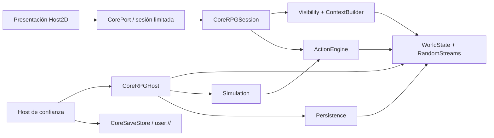

# Arquitectura de GDExtension

Main integrado: `cd1735b1c9a1bb7507a3b1ce42d96c6d103b0977` (NIM-05 / PR #22).
CoreRPG `4f282863737bcd8f5add401202a9e1064c133672`; godot-cpp oficial
`e83fd0904c13356ed1d4c3d09f8bb9132bdc6b77`, API 4.5; Godot **4.7.2 Standard**.
Código verificado: `9924cc38f2fb1162e49ad80779db76c8e5d3f886`.
[CI nativa 39483287563](https://github.com/robdor80/Videojuego_Nimroel/actions/runs/39483287563) y
[regresiones 39483287443](https://github.com/robdor80/Videojuego_Nimroel/actions/runs/39483287443): success.
Checkout PR automático `7296c1eb43eaf3da96cc9d995f13bcdb9cb9c7eb`, árbol idéntico al HEAD de código.
[Pins](evidence/dependencies.json) · [Evidencia vigente](evidence/ci-summary.json) ·
[Integración NIM-05 y conservación de fuentes](11_INTEGRACION_MAIN_NIM05.md).
No se ha fusionado ninguna PR ni modificado main. Las pruebas físicas no están realizadas.

## Vida útil y aislamiento

CoreRPGHost es RefCounted y posee un Runtime privado. Runtime posee una única
campaña activa con WorldState y RandomStreams. Las sesiones solo mantienen
weak_ptr al Runtime; no prolongan la vida del mundo ni contienen un puntero al
Host. Destruir el Host deja las sesiones expiradas. Cada instancia es independiente.
No hay singleton nativo, red, callbacks del Core ni señales reentrantes.

La extensión registra ambas clases al nivel SCENE y no mantiene recursos globales
al cerrarse. `reloadable=false`: no se recarga código mientras hay objetos vivos.
Se acepta únicamente el hilo creador y se devuelve WRONG_THREAD en otro hilo.
Las operaciones y destructores de sesión coordinan el acceso con un mutex.

Inicialización, restauración y cierre incrementan generación y anulan todas las
sesiones. Un restore fallido conserva campaña y generación. IDs/revisiones iguales
no vuelven a autorizar una capacidad antigua. El Host debe abrir nuevas sesiones.

## Comunicación

El contrato de transporte tiene versión 1, campos cerrados y tipos estrictos.
La API Godot usa Dictionary/PackedByteArray; los valores se validan y se convierten
a los DTO C++ tipados del Core. No se serializa memoria, padding, punteros o spans.
Los campos uint64 privilegiados usan decimal String canónico para no truncar a
los 63 bits positivos de Variant. IDs están acotados a 4096 para esta vertical.
[Esquemas completos](../../Game/BridgeCoreRPG/native/README.md).

Session.context fija el observador en C++, crea ObserverView y la selecciona
mediante ContextBuilder. Mantiene procedencia, ausencia conocida y truncamiento.
El context_id es una correlación local creciente, no una revisión ni identidad de
mundo. Cada consulta sustituye el ticket anterior; caduca a los 60 segundos.
Session.submit exige ticket vigente, request_id creciente, actor implícito, permiso
explícito y destino autorizado. La revisión se enlaza solo en memoria nativa.

Los recibos de sesión contienen outcome, request_id, status/error y events vacío.
No hay stream de eventos autorizado en el Core; no se inventa. Las consecuencias
se consultan mediante una vista nueva. No se entrega ActionResult ni revisión.
Solo Host.step obtiene diagnósticos técnicos privilegiados de Simulation.

## Publicación y atomicidad

El adaptador prepara candidatos usando los mismos tipos y operaciones Core; no
implementa un segundo motor. Convierte/valida la solicitud completa antes de
Simulation. Un batch de esquema inválido no procesa prefijo. Core mantiene su
atomicidad por acción y, ante interrupción, su prefijo procesado explícito.
Las cuotas del puente se comprueban antes de publicar el candidato; excederlas
rechaza la operación del puente completa. No hay reintento ni replay automático.
El coste de copiar la campaña es O(estado); es una elección conservadora y acotada,
no una promesa de rendimiento para mundos grandes.

CoreSaveStore posee rutas y I/O; Persistence posee formato, checksum, mundo y RNG.
.tmp/.bak permite recuperar una interrupción entre renombrados, sin prometer una
transacción duradera frente a pérdida eléctrica. Un archivo corrupto no se
sustituye silenciosamente por otro. UI recibe errores y nunca repara estado.

Verificaciones: destrucción, cierre, separación de instancias, restore, contexto,
acciones y rechazo de hilo en native_bridge_probe.gd; resultados nuevos en 04/05.
