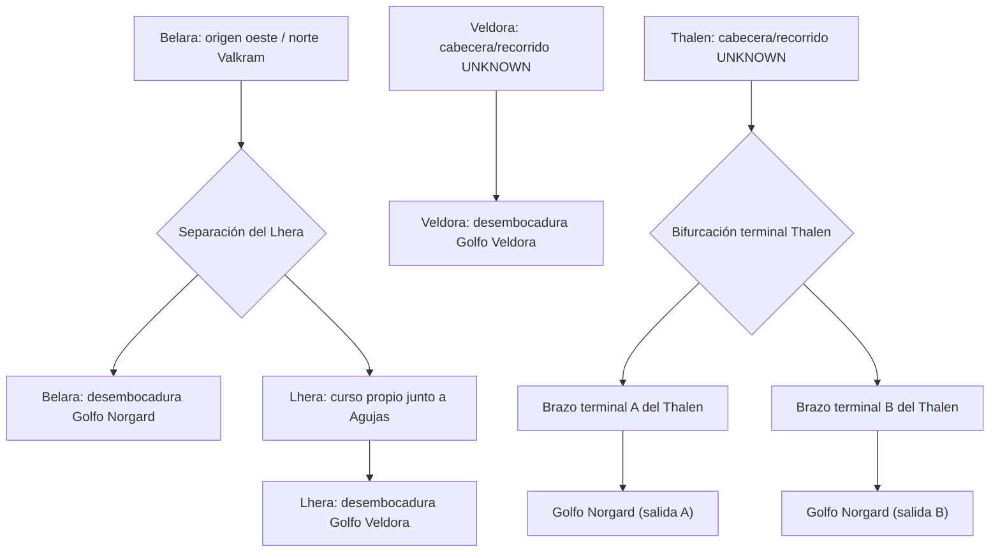

# DAROVAN D02 — Red hidrográfica y grafo conceptual v0.1

**Estado:** DESARROLLO DOCUMENTAL / NO CANÓNICO / NO RUNTIME (15-10-2026).
**Base:** D01 integrada en main por PR #15, merge 9f3f723b0e7b2b78567c6397bba7099bfe658b0a.

## Autoridad y método
1. **AUTHORED/CANON**: `Worldbuilding/Reinos/Reinos de los Hombres/Norgard/Geografía/rios_y_lagos.md`, §§3–6; `mares_y_costas.md`, §§5,8; `bosques.md`, §1.1; `Norgard/Ciudades/Casa Darovan/Treihord.md`, §6, y decisiones DAR-A01–A05.
2. **NIMROEL CORE**: `Worldbuilding/Sistemas/Nimroel Core/Geografia fisica/geografia_fisica_drenaje_hidrografia_v0.1.md` + contrato JSON: drenaje descendente, divisorias, conectividad, UNKNOWN y persistencia.
3. **DERIVED**: lectura topológica del canon, no coordenadas.
4. **PROPUESTA TÉCNICA**: claves `d02_*`, flechas de conectividad, reservas `UNKNOWN`; no hidrónimos nuevos ni segmentos de mapa.
5. Jerarquía: Nimroel Core → Norgard Defaults → Casa Darovan → Localidad → World State. El canon original y las decisiones del autor prevalecen sobre el perfil D02.

## Cuatro ríos y tres sistemas topológicos
| Río | Afirmación AUTHORED | Limitación/UNKNOWN |
|---|---|---|
| **Belara** | Nace en vertiente **occidental septentrional** de Valkram, discurre al oeste, pasa **junto** a Treihord **sin atravesarla** y termina en Golfo de Norgard | Tramo exacto de separación del Lhera, perfil longitudinal, afluentes y cotas |
| **Lhera** | Curso con identidad propia **desde su separación del Belara**; discurre junto a una linde del Bosque de las Agujas y termina en Golfo de Veldora | Posición de separación y trazado; nunca afluente del Veldora |
| **Veldora** | Río **independiente del Belara y el Lhera**; desemboca en Golfo de Veldora y presta nombre a la ciudad | Cabecera, recorrido, boca exacta y relación espacial del cauce representado detrás de la ciudad (DAR-P07) |
| **Thalen** | Río de la península meridional; se divide **en el tramo terminal** en dos brazos que enmarcan Taramin; vierte al Golfo de Norgard | Cabecera, disposición relativa de brazos, exactitud de la isla/interfluvio, mareas y puentes |

**Interpretación de cuenca:** Belara + Lhera constituyen **una red conectada con dos salidas marinas**; no forzar un modelo de árbol con una sola desembocadura ni dos cabeceras independientes. Veldora es una **red distinta**; Thalen es **una red distinta con bifurcación terminal**, no dos ríos. Los golfos compartidos NO indican conexión entre cauces interiores.

## Grafo conceptual — NO es geometría ni orden completo de todos los hitos

**Referencias de adyacencia no ordenadas:** Treihord es **adyacente** al Belara, no está atravesada por él; Taramin queda **entre los brazos**; Agujas es **adyacente** al Lhera. No se conoce si el punto de separación Lhera está aguas arriba o abajo del tramo contiguo a Treihord: el grafo NO codifica ese orden. `A` y `B` no denotan izquierda/derecha, norte/sur ni posiciones absolutas.

## Invariantes anti-regresión
- El Belara jamás desemboca en Golfo de Veldora; el Lhera jamás se desconecta del Belara; el Veldora jamás recibe borde de unión desde Belara/Lhera; el Thalen conserva solo un río con dos brazos terminales.
- Treihord tiene un **puerto industrial fluvial** para **barcazas de poco calado**, no dársena para buques marítimos. Minerales: minas → carros → carga fluvial → barcazas → Treihord. Carbón importado de los Azurios; no inferir su ruta.
- **No** reintroducir «Eshneva» como hidrónimo operativo (DAR-A03); **no** identificar el río visual tras Veldora (DAR-P07).
- Ningún segmento `d02_*` equivale a geometría materializada o nombre diegético; nombres canónicos solo Belara, Lhera, Veldora y Thalen.
- Arven **no** se adjudica a Darovan; Karsath **fuera**; Syvaris es Darovan. Bosque de las Agujas sin asentamientos permanentes interiores.

## Trazabilidad
- `Geografía/rios_y_lagos.md`: §§3–6, cuatro cursos, origen/Boc​as/relaciones.
- `Geografía/mares_y_costas.md`: §§5 y 8, golfos receptores.
- `Geografía/bosques.md`: §1.1, Agujas y Lhera.
- `Ciudades/Casa Darovan/Treihord.md`: §§5–7, periferia y puerto fluvial.
- `Territorios/Casa Darovan/Geografia_local/01–03`: restricciones D01, NO fuentes originales superiores.
- `Datos operativos/darovan_d02_hydro_network_v0.1.json`: grafo lógico máquina, expresamente sin coordenadas.

No constan en estas fuentes ríos menores Darovan identificados, alturas de nacimiento ni aforos verificables.
